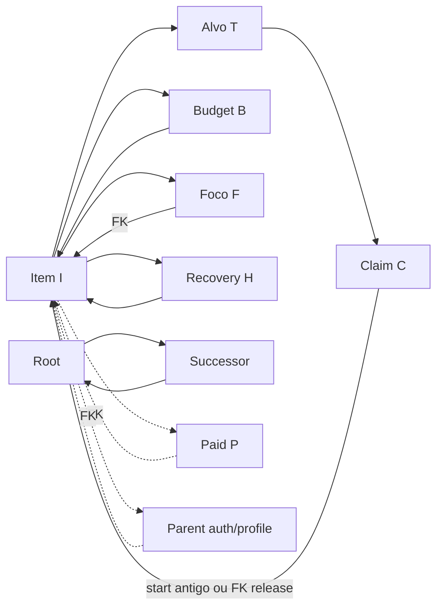

# Single-Item V1 — decisão sobre a estratégia de locks

2026-10-09. Proposta para revisão humana; implementação e prova PostgreSQL não
aprovadas nesta sessão. Substitui a recomendação de aplicação transversal do
[Plano 045](../planos/045-single-item-lock-review.md), preservando seu inventário,
grafo e diff como evidências históricas. Não aprova os 59 corpos.

## Decisão recomendada e alcance

Preparar primeiro um candidato localizado de **dois corpos**:
`public.start_claimed_work_attempt(uuid,uuid,text)` e
`public.release_work_claim(uuid,text)`, ambos com item do próprio claim antes do
claim. Comparar com o baseline em PostgreSQL descartável antes de decidir uma
migration nova. Não editar migrations históricas. A garantia pretendida é estreita:
eliminar a inversão item/claim nos participantes acquire/start/release do mesmo
item, sob entradas canônicas sem locks prévios incompatíveis. Não é uma solução
global de deadlocks nem libera `single_item_atomic_claim_unavailable`.

Uma mudança apenas em start resolve o par original no modelo, mas cria a inversão
start `I→C` versus release `C→I_fk`. A liberação participa necessariamente para
esse conjunto mínimo não introduzir esse novo ciclo. Seu INSERT de evento toma
lock de FK no MESMO item; não pode ser descartado da análise por não escrever item.
Não há necessidade de adicionar B às 59 funções para testar essa hipótese.

O 40P01 recuperado é evidência real, mas a reprodução usou pré-locks manuais
opostos. Reexecutar esse controle com os mesmos pré-locks pode continuar dando
40P01 mesmo no candidato correto. Exigir também reprodução por entradas naturais;
se ela não reproduzir no baseline, registrar precisamente esse limite, sem alegar
que um deadlock natural foi corrigido experimentalmente.

## Comparação

| Critério | Localizado: start + release | Prefixo B comum por owner |
|---|---|---|
| Segurança | Releitura bloqueada e correlação; nenhum claim estrangeiro alterado | Mutex cooperativo; depende de todas as entradas, identidade fixa e locks anteriores |
| Escopo mínimo | Dois corpos para o domínio mesmo-item; acquire global/scoped já tomam I antes de C | Para o par original, acquire global, scoped e start devem entrar em B antes de I/C; release amplia o fechamento. Para todos os ciclos, fechamento transversal ainda não certificado |
| Itens independentes do mesmo usuário | Preserva paralelismo até recursos realmente compartilhados; orçamento continua compartilhado nos caminhos existentes | Serializa toda duração da transação, incluindo classificação, foco, conclusão e recovery, mesmo em alvos distintos |
| Usuários distintos | Linhas/alvos separados podem progredir; índices/FKs/admin ainda podem acoplar | B usa owner distinto; não prova isolamento de recursos globais ou operações multiowner |
| Throughput/latência | Menor expansão de contenção; item fica bloqueado antes em start/release | Head-of-line blocking; transação longa atrasa todos os participantes do owner; risco de lease expirar na fila |
| Starvation | Nenhuma garantia de justiça; depende das filas reais | Nenhuma garantia de justiça; mutex não é scheduler nem substitui limites de duração |
| Deadlocks residuais | Alvo/claim entre itens, orçamento/item, foco, recovery, parent/FK | Grafo inferior continua cíclico; não participantes, prefixo tardio e multiowner podem fechar ciclos |
| Substituibilidade | Contrato SQL pequeno; executores continuam substituíveis | Todo futuro escritor precisa conhecer protocolo global implícito; forte acoplamento entre capacidades |
| Manutenção | Dois corpos, regressões explícitas; extensão por ciclo comprovado | 59 inserções são limite de proposta textual, não prova de mínimo nem cobertura completa |

Não há números medidos de throughput, p95 ou starvation nesta sessão. No caso
ilustrativo de dois alvos independentes com transações de duração d1 e d2, B impede
sobreposição dos participantes enquanto retido; o limite serial d1+d2 não estima
performance real. A alternativa localizada também não garante paralelismo total:
T, B existente, foco e recovery podem ser compartilhados.

## Escopo e protocolo do candidato

As duas definições atuais vêm de `20260721000001_work_claims.sql`. Manter auth,
allowlist e validação de argumentos antes de qualquer aquisição. Depois:

1. Ler claim filtrado por `id` e `user_id`, sem lock, só para localizar item.
   Ausente mantém P0002. Nenhuma decisão de validade usa esse snapshot.
2. Bloquear apenas `work_items.id = discovered_item AND user_id = auth.uid()`.
3. Reconsultar o claim com FOR UPDATE e o mesmo owner; verificar novamente
   existência e correlação ao item descoberto. Se sumiu, P0002; relação alterada
   por escritor privilegiado deve abortar fail-closed, sem seguir outro item.
4. Executar as verificações originais de replay, attempt, released, expiry e
   reason com a linha bloqueada. Start delega ao begin existente, cujo I é
   reentrante; release atualiza apenas esse claim e emite seu próprio evento.

Diff conceitual por corpo, **não aplicado** (a implementação exata, mensagens e
SQLSTATE do caso de corrupção exigem revisão antes de produzir migration):

```diff
 DECLARE
+  v_discovered_item uuid;
 BEGIN
   -- validações existentes intactas
+  SELECT c.work_item_id INTO v_discovered_item FROM public.work_claims c
+  WHERE c.id=claim_id AND c.user_id=v_user_id;
+  IF NOT FOUND THEN -- mesmo P0002 original
+    RAISE EXCEPTION 'claim not found' USING ERRCODE='P0002';
+  END IF;
+  PERFORM 1 FROM public.work_items i
+  WHERE i.id=v_discovered_item AND i.user_id=v_user_id FOR UPDATE;
+  -- falha fechada se item ausente; não adquirir claim de outro item
   SELECT * INTO v_claim FROM public.work_claims c
   WHERE c.id=claim_id AND c.user_id=v_user_id FOR UPDATE;
   IF NOT FOUND THEN -- P0002 original, corpo preservado
+  -- verificar v_claim.work_item_id = v_discovered_item
   -- regras e efeitos originais, sem mudanças
```

Isso preserva assinatura, ACL, SECURITY DEFINER/search_path e corpo de negócio,
mas altera momento/duração da espera. Erros em condições concorrentes podem mudar
por releitura/espera; replay passa a esperar I mesmo se já concluído. Medir essa
regressão, não afirmar compatibilidade perfeita. Nunca liberar/adotar claim de
outro item para facilitar Single-Item. A guarda scoped contra claim estrangeiro,
inclusive expirado, permanece antes da delegação global e sem mutação estrangeira.

## Fechamentos alternativos e operações incompatíveis

Para T antes de I/C em entradas naturais, o conjunto direto inclui acquire global,
acquire scoped, private.begin_work_attempt, start_claimed e os três begin_*resumed
(supervisionado/human decision/budget interruption). Release precisa continuar
compatível com I/C; global precisa ordenar os itens estrangeiros envolvidos em
expiração e eventos FK. Esse conjunto é um ponto de partida, não fechamento global:
requere descoberta de target sem lock seguida de revalidação e preservação do replay.
Trocar espera por NOWAIT em acquire eliminaria uma aresta, mas introduziria 55P03 e
recusas sob contenção; não é a recomendação para preservar semântica.

Para B comum, o mínimo do par reproduzido exige prefixo nas entradas acquire global,
scoped e start, nunca só no private.begin após C. O fechamento ampliado do 045
inclui liberação, terminais, retomadas, orçamento, reconciliação, foco, recovery,
classificação/routing, contexto e evidências. Helpers internos são redundantes
somente se todos os callers/ACL forem comprovadamente fechados. Os 59 corpos não
constituem mínimo demonstrado; cinco já B-first e readers/wrappers devem ser
tratados por suas entradas, conforme [inventário](../planos/045-single-item-lock-inventory.json).

Não é possível afirmar prefixo antes de todo lock relevante em todos os caminhos:

- `private.enforce_autonomous_work_budget` (trigger `enforce_autonomous_work_budget_before_start`) adquire B no trigger depois de
  locks do caller; adicioná-lo ali não corrige I→B. Callers precisam chegar B-first.
- `clear_terminal_work_focus` roda após UPDATE de item, toma F; não pode estabelecer
  prefixo universal tardiamente. `attach_initial_work_context` também herda DML/FKs.
- Paid grant/reserve/void/settle/confirm/fail_closed toma autorização P e FKs de
  item; os sete corpos pagos foram excluídos do diff. Não são cobertos por ele.
- DML de service_role, locks manuais, DELETE/cascades de auth/profiles e escritores
  privilegiados não seguem automaticamente protocolo advisory. RPCs não podem
  obrigar o primeiro lock de uma transação que o caller já começou.
- `authorize_work_resume(uuid,integer,uuid,jsonb)` toma successor/root; replan e
  `record_recovery_successor` têm I/H em ordens diferentes. Readquire B no helper
  não salva um caller que já detém I sem B.
- Transações compostas com owners diferentes podem formar B:u→B:v versus B:v→B:u.
  Nenhuma RPC canônica multiowner foi demonstrada; composição privilegiada e
  deleções administrativas são casos multiowner relevantes. Exigiriam protocolo
  separado de owners ordenados antes de qualquer outro lock, não esta proposta.

FK KEY SHARE conflita com FOR UPDATE do item; triggers executam na transação do
caller e podem alcançar outras linhas. Referências:
[PostgreSQL 15 — locks](https://www.postgresql.org/docs/15/explicit-locking.html) e
[triggers](https://www.postgresql.org/docs/15/trigger-definition.html).

## Grafo, ciclos e limites da prova



| Ciclo | Evidência e candidato localizado |
|---|---|
| I→T→C→I mesmo item | 40P01 real com pré-locks; candidato fecha o par nas entradas naturais cooperativas |
| I→T→C_foreign→I_foreign | Inferido no global; permanece, sobretudo limpeza de claim estrangeiro expirado |
| T→C_foreign→T | Acquire de outro item versus start; permanece mesmo após item-first |
| I→B→I | Start/retomada versus authorize/block/interrupt/readmit B-first; permanece |
| I→F→I_fk | Terminal versus focus UPSERT; permanece |
| I_root→H→I_root | Recovery wrapper versus helper; permanece |
| I_root→I_successor→I_root | Potencial; alcançabilidade real sob precondições ainda não demonstrada |
| I→P→I_fk | Condicional a parent DELETE/cascade/ledger pago; permanece fora do escopo |
| Parent→I→Parent_fk | Condicional a admin/delete; permanece fora do protocolo canônico |

Reconciliation usa R→itens ordenados→claims; não foi demonstrada inversão I→R.
B comum não remove essas arestas: impede algumas combinações concorrentes quando
TODOS os participantes obedecem o prefixo com owner fixo. O modelo offline
exibe contraexemplos para trigger tardio, não participante, pré-lock e multiowner.
Dois participantes, locks exclusivos e sequências fixas não demonstram ausência
universal de deadlocks, justiça, MVCC, catálogo real ou performance.

## Fronteira de aceitação

Aceitar os dois corpos apenas após a [comparação real](../planos/046-single-item-lock-strategy-proof.md)
passar a matriz localizada sem novo ciclo start/release e com contratos preservados.
Rejeitar se aparecer mutação estrangeira, alteração de orçamento, novo ciclo no
escopo, piora acima dos limites predefinidos ou resultado sem evidência independente.
Reverter o candidato no ambiente de provas e reavaliar se falhar; eventual rollback
em produção será migration revisada, nunca edição histórica/reset. Aprovação do
candidato não significa GO do produto: os ciclos residuais exigem decisão separada.

As 123 propriedades históricas recuperadas são cobertura preparada de harness,
não 123 PASS PostgreSQL. As 55 Single-Item continuam preservadas. A divergência
local/externo V2 versus orçamento V1 permanece resultado esperado de incompatibilidade
histórica e decisão de política separada; não adaptar guardas para produzir verde.

## Evidência PostgreSQL posterior — 2026-10-09

[Comparação real](../registros/2026-10-09-single-item-comparativa-vector-prova.md):
dois corpos aplicados só em cluster descartável, atributos/ACL/RLS preservados.
Quatro pares item/claim baseline 40P01 versus candidato sem deadlock em cenários
controlados; pré-locks adversariais permanecem 40P01. Ciclo item/budget também
comprovado nos dois, portanto a proposta localizada não fecha esse domínio.
55 Single-Item PASS em ambos, quatro falhas históricas idênticas de orçamento;
p95 replay +29,4% no microbenchmark limitado. Revogação durante espera passa
a recusar 42501 no candidato. NO-GO para promoção, revisão humana e escopo
separado para budget/item; diff 59 corpos continua sem aprovação.
