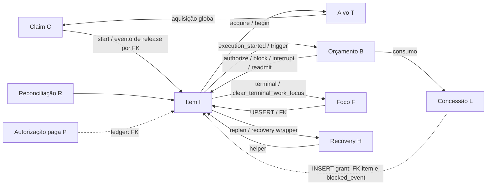

# 045 — Revisão dos locks e recuperação das fixtures Single-Item V1

09/10/2026. dev @ `6bc4aadef9414d655600c2ea37c6be436b3628c8`, com WIPs.
Autorização: análise e testes/fixtures offline, proposta SQL sem aplicar.
Atualiza criticamente o [Plano 044](044-single-item-lock-order-proposta.md), cujo
rascunho é histórico e não deve ser aplicado. [Prova original](../registros/2026-10-08-single-item-provas-reais.md).

## Inventário e limites da evidência

[Inventário completo](045-single-item-lock-inventory.json): 139 definições textuais
vigentes relacionadas a work/compute e dependências, 12 triggers declarados ativos;
assinatura (inclusive overload), fonte/linha, hash do corpo, statements explícitos,
callees, identidade e disposição de cada caminho. Scanner percorreu todas as
161 definições finais do corpus, tratando comentários, strings, dollar bodies,
DROP, ALTER RENAME e aliases public. Nenhuma consulta pg_catalog foi feita.
Uma função não suportada pelo scanner causa erro, não omissão silenciosa.
O inventário descreve o REPOSITÓRIO COM WIPs, não prova schema residente/aplicado.

| Família | Funções relevantes | Recursos e decisão da proposta |
|---|---|---|
| Claims | acquire_single_item_work_claim, acquire_work_claim, start_claimed_work_attempt, release_work_claim | Prefixo B antes de item/claim, mantendo as verificações existentes |
| Início | start_commanded_work_attempt→private.begin_work_attempt; start_work_execution; start_work | Corpo comum recebe B; wrappers sem recursos próprios herdam o prefixo |
| Conclusão | record_commanded_work_terminal, finish_work_execution, submit_work_result, review_work_result/versioned, release_mandated_result | B antes de linhas/trigger de foco; evidência/Verifier e transições não alterados |
| Retomadas | begin_resumed_work_attempt, begin_human_decision_resumed_attempt, begin_budget_interruption_resumed_attempt | B antes de item/alvo/claim/trigger de orçamento |
| Reconciliação | reconcile_supervised_work vigente em 20260928000004 | B antes de R; conserva ORDER BY id, claims, abandono/materialização, nenhum início |
| Orçamento | interrupt_work_on_budget, block_work_on_budget, readmit_budget_blocked_work/interrupted_work e helpers; authorize_work_resume(uuid,integer,jsonb) | Entradas que já tomam B primeiro ficam intactas; helpers reforçam prefixo reentrante |
| Decisão/controle | request_work_control, apply_work_control_at_checkpoint, record_work_decision_required, respond_to_work_decision | B antes de item/claim; sem autoridade nova |
| Recovery/lineage | record_recovery_successor, replan_failed_work, authorize_work_resume(uuid,integer,uuid,jsonb), authorize_*_recovery, request_work_retry | B antes de H ou item, mesmo no caminho sucessor→root |
| Classificação/routing | record_work_intelligence_classification, record_work_routing_adjustment/decision, record_compute_routing_decision/preference | B antes de item; não modificar validade, escolha de provider ou políticas |
| Proposta/foco/contexto | create/revise/request_revision/resolve_approval/auto_approve, set_work_focus, attach_work_context, materialize_project_backlog_proposal | B antes de primeira linha/UPSERT; foco recebe B antes de ler estado |
| Evidência/integração | record_host_observed_*; record_verifier_opinion; resolve_pending_verification; decide/authorize/record integração/publicação/review | B antes de item, preservando writer/Verifier/aceite/ACL |
| Supervisão/manual | grant/revoke_work_supervision, withdraw_approved_work, release_manual_work | B antes de item ou lease; não introduzir concessão nas fixtures |
| Pago (fronteira) | grant_paid_compute_authorization, reserve_paid_compute_budget, void/settle/confirm/fail_closed de reserva | P antes de ledger/FK de item; nenhum diff nesta família; não é chamado pelos caminhos Single-Item |

59 corpos precisam de prefixo novo; cinco já o têm; três triggers mutantes herdam
prefixo da RPC (não inserir B tardiamente neles); sete corpos mutantes pagos ficam
separados; 65 definições são readers, validadores, triggers sem lock novo ou wrappers.
Esses rótulos são da análise textual, não uma certificação de catálogo.

## Grafo de dependências

B = advisory `autonomous_work_budget:<owner>`; R = `work_reconciliation:<owner>`;
H = `work_recovery_successor:<owner>:<idempotency>`; I = linha work_items;
T = advisory `work_target:<owner>:<target>`; C = linha work_claims;
L = budget_resume_authorization; F = work_focus; P = paid_compute_authorization.
I_fk é o MESMO recurso de linha I, solicitado em KEY SHARE pela FK.
I_root/I_successor são linhas distintas, não duas classes independentes de tabela.

O grafo estático tem ciclos mesmo quando prefixos serializam entradas; não declarar
que ficou DAG após adicionar B. A prova precisa distinguir precedência de aquisição
nas chamadas e grafo de ESPERA entre transações. No [teste finito](../../supabase/tests/single_item_lock_review_test.py)
foram enumerados interleavings dos pares abaixo e 196 pares com prefixo comum.

| Ciclo/família | Evidência e alcance |
|---|---|
| C1 I→T→C→I | 40P01 real: acquire/scoped toma item, tenta claim; start já tem claim e espera item. Inclui release C→I_fk quando insere evento |
| C2 I→B→I | Inferido por código: begin/retomada insere start sob item, trigger espera B; authorize/block/interrupt toma B e espera item |
| C3 I_b→T→C_b→I_b_fk | Inferido: global mantém alvo/claim alheio e insere evento nesse item; sua dona mantém I_b e espera T. Scoped recusa antes desse efeito; não confundir com global |
| C4 I→F→I_fk | Inferido: terminal atualiza item e trigger AFTER apaga foco; UPSERT de foco bloqueia F e FK espera item |
| C5 I_root→H→I_root | Inferido: wrapper de recovery bloqueia predecessor e chama helper H; helper direto mantém H e busca predecessor |
| C6 I_root→I_successor→I_root | Risco entre ordem UUID em operações em lote e sucessor→root na autorização. A existência de dados que satisfaçam ambas as pré-condições precisa prova negativa; não foi reproduzido em SQL |
| Limite C7 I→P→I_fk | Condicional a DELETE/cascade do item contra operação paga que mantém P e insere ledger com FK I. Não há I→P no caminho normal Single-Item; não inferir ciclo operacional vivo de simples reader de paid rows |
| Limite C8 Profile/auth→I→Profile/auth_fk | Condicional a remoção de usuário/parent por admin versus INSERT de claim/contexto/evento. Exclusão estrutural não participa do mandato Single-Item |

Classes acima descrevem famílias, não alegam listar todo deadlock possível de SQL
arbitrário. Cycles adicionais combinados, múltiplos owners na mesma transação e
DDL/índices/PKs globais com chamadas compostas são limites explícitos, fora da prova
finita. Reconciliation R não tem aresta inversa I→R em chamada normal inventariada;
quando recebe B, a ordem é B→R→I. Nenhum novo ciclo B→R→B entre participantes.

### Aquisições implícitas e callbacks

- INSERT em work_events/work_contexts/work_claims/work_focus pede KEY SHARE em
  work_items pelas FKs. FOR UPDATE de item conflita com KEY SHARE; NO KEY UPDATE
  não. Não trocar modo de lock para resolver isso sem revisar contratos. Isso
  fundamenta C3/C4; o recurso não é uma leitura MVCC comum. Ver também o
  [código RI do PostgreSQL 15](https://github.com/postgres/postgres/blob/REL_15_STABLE/src/backend/utils/adt/ri_triggers.c).
- work_claims.user_id→profiles; work_items.user_id/source_message→parents; ledgers
  de autorização→item/evento/lineage; paid_compute_budget_events→P e I. INSERTs
  devem preservar ownership canônico; registros admin corruptos entre owners
  invalidam a hipótese do prefixo. Preflight futuro deve verificar essas relações.
- UPDATE somente de consumed_at/released_at não muda FK: não inventar nova aquisição
  do parent por qualquer UPDATE. A FK de grant novo e seu blocked_event existe;
  os eventos/parents são imutáveis no fluxo normal (sem DELETE).
- Trigger de orçamento BEFORE start toma B e pode UPDATE L. Inteligência e routing
  BEFORE claim/start e adjustment BEFORE route leem fatos; não tomam FOR UPDATE.
- clear_terminal_work_focus AFTER item atualiza/apaga F. attach_initial_work_context
  AFTER work_proposed insere contexto/evento e suas FKs. Ambos devem herdar B
  já adquirido pela RPC. Guardas Verifier/monotonic/trusted writer/canonical resident
  e no_resume_authority_descendants fazem validações/leitura; catálogo futuro deve
  confirmar que são exatamente os corpos/hashes inventariados, sem callbacks extras.
- Relation locks ROW SHARE/ROW EXCLUSIVE/ACCESS SHARE são compatíveis entre DML
  normal desses caminhos; DDL/TRUNCATE/DELETE de parents não integra este escopo.
  Índices únicos podem gerar espera de XID; deadlock por sequência de múltiplas
  RPCs/IDs compartilhados não deve ser descartado por ausência de advisory inverso.

[PostgreSQL 15 — locking](https://www.postgresql.org/docs/15/explicit-locking.html)
e [triggers](https://www.postgresql.org/docs/15/trigger-definition.html) fundamentam
modos, reentrância, duração transacional e execução de callbacks. Catálogo real e
observação de blockers continuam indispensáveis. Para STABLE, considerar
[snapshots](https://www.postgresql.org/docs/15/xfunc-volatility.html), sem alterar
volatilidade do orçamento para mascarar um teste.

## Estratégia recomendada (revisa a ordem linear do Plano 044)

**Prefixo B único antes de qualquer recurso mutante/lock explícito em cada entrada
participante; depois conservar o corpo e sua ordem local existente.**

Não recomendar agora reordenação total B→I→T→C→L como se todas as FKs e caminhos
ancestrais a obedecessem. O rascunho anterior antecipava validação de alvo em start,
mudando erros/replay, e não cobria todos os writers. O novo candidato adiciona
somente PERFORM do mesmo advisory B, nos 59 pontos discriminados; nenhum corpo,
validação, quota, RPC global/scoped, grant, índice ou search_path é reescrito.

Sob um único owner fixo por transação, participantes não pré-bloqueiam recursos
inferiores enquanto esperam B: somente uma transação por owner entra no trecho
mutante. Por isso os ciclos C1–C6 não viram ciclos de ESPERA entre participantes,
embora permaneçam no grafo estático. O modelo testa essa hipótese e também mostra
contraexemplos para quem pré-bloqueia C/I sem B ou toma B de dois owners invertidos.
B é lock, não escrita em outro item nem autorização de compute.

[Diff SQL explícito](045-single-item-lock-review.diff): 59 linhas adicionadas, zero
linhas de corpo removidas, em 42 arquivos-fonte históricos. É mapa de corpos vigentes
para revisão; NÃO aplicar às migrations antigas. Após aprovação, montar nova migration
aditiva CREATE OR REPLACE das versões completas com ACL/owner/search_path preservados.
Nenhuma migration real ou pacote de bootstrap foi alterado nesta sessão.

### Requisitos e custos da estratégia

- Unidade suportada: uma RPC/transação com auth.uid/owner fixo; sem locks inferiores
  adquiridos pelo chamador antes da RPC. Garantir isso no transporte da próxima
  prova. Advisory não obriga SQL direto/service_role/admin a cooperar. Trigger de
  budget isolado NÃO corrige esse problema, pois pode chegar depois de I/C.
- Não afirmar ausência universal para DML direto, exclusão, múltiplos owners,
  corrupção de ownership ou extensões futuras. Promoção depende de auditoria das
  chamadas/transações reais e preflight de catálogo/ACL, não de um helper no app.
- Serialização entre alvos diferentes do mesmo owner aumenta latência, inclusive
  classificação/terminal/foco. Avaliar p95/p99, tempo de B, filas e starving; nenhum
  contrato FIFO deve ser prometido. Transação curta, sem provider/rede/compute dentro
  dela, lock/statement deadlines; timeout = recusa tipada/FAIL, nenhum retry implícito.
- now()/v_now continuam timestamp da transação. Lease/autoridade pode expirar em
  clock_timestamp durante espera; esse risco existente fica ampliado. Testar fronteira
  de lease e janela real antes de autorizar implementação/liberação; qualquer mudança
  de relógio/renovação requer diff e contrato separados, não alteração silenciosa.
- Preservar ordem de erros significa manter checks nos mesmos pontos; um lock timeout
  novo pode anteceder erro de domínio em disputa. Sem disputa, bodies/erros são os
  mesmos. Foco toma B antes de ler estado, evitando snapshot velho criado pela nova
  espera; entradas com dados mutáveis pré-lidos precisam revalidação factual em SQL.
- Paths privados reforçam B de forma reentrante; callbacks mutantes não recebem B
  tardio. Algumas funções financeiras só travam P e podem esperar I por FK; não
  ganham autoridade Single-Item nem alterações neste candidato. C7/C8 são bloqueios
  para uma garantia que inclua manutenção/deleção, não para declará-los inexistentes.

### Isolamento Single-Item

Scoped faz SELECT EXISTS de claims alheios SEM expires_at e recusa antes de delegar
acquire_work_claim. Sob B e T mantidos, nenhuma outra aquisição global/scoped
participante pode inserir/liberar claim entre guarda e delegação. Global conserva
seu comportamento histórico; scoped só permite a expiração/substituição do próprio
claim. Start/terminal/release filtram claim/item correlacionado, sem manutenção global.
O novo diff não adiciona UPDATE/DELETE/eventos: apenas lock por owner, que pode
bloquear operações de vizinhos, mas não modifica suas linhas. Índices/RLS/ownership
precisam catálogo real; DML privilegiado não participante pode invalidar a guarda.
Snapshots integrais de todos os itens/claims/eventos/autorizações alheios continuam
gate obrigatório, inclusive claim alheio vencido e global concorrente.

## Fixtures reformuladas e harness

[Diff das fixtures e instrumentos offline](../registros/2026-10-09-single-item-cobertura-fixtures.diff).
As cinco suítes agora não desabilitam nenhum trigger. Helper temporário
[guarded_history.inc](../../supabase/tests/helpers/guarded_history.inc) fornece
classificação válida, adjustment/routing canônicos, executor correlacionado,
claims históricos e starts com todas as guardas ativas. Não emite grants de
supervisão, orçamento, writes no residente ou compute. Timestamps/estados são
fatos sintéticos controlados dentro de BEGIN/ROLLBACK, não execução operacional.

| Suíte | Asserções preservadas | Mudança de fixture |
|---|---:|---|
| work_budget | 15 | Starts históricos admitidos com claim/route; preparar candidato/route da 4ª recusa antes de block; runtime classificado/roteado antes de in_progress |
| work_budget_local_vs_external | 12 | Helpers aprovados, classificados e roteados; 3+3 starts com guardas; conservar TODAS as expectativas V2, mesmo quando V1-supervision as contradiz |
| budget_blocked_human_resume | 16 | Classificação fictícia removida; histórico 3+3 em dois itens, claims encerrados; tokens/recusa por orçamento com candidates/executor/routes válidos |
| work_budget_interruption_resumption | 15 | Route/classificação da attempt antiga e route do executor worktree-v1 para a retomada; janela envelhecida explicitamente na fixture sintética original |
| supervisor_reconciliation | 65 | Budget ativo; quatro starts sob claim mais um retry (cinco/6); comandados não entram nesse consumo; t5 declara duas attempts para testar abandono e nova attempt sem exceção |

123 propriedades históricas + 55 Single-Item = 178 comparadas por hashes normalizados
no [contrato](../../supabase/tests/fixtures/single_item_assertion_contract.json).
Normalização permite apenas whitespace e executor_id correlacionado nos payloads
antigos; não troca expectativas, SQLSTATE ou labels. Single-Item 55 e runner da
sessão anterior ficaram byte a byte intactos; decoder/EPIPE foram reavaliados pelos
testes existentes, sem alargar tolerância de cleanup.

Janela de interrupção/reconciliação conserva UPDATE de created_at de eventos
EXCLUSIVAMENTE sintéticos, já existente na fixture transacional, e ajustes de estado/
lease necessários aos casos de crash. Isso NÃO é procedimento de produção nem
prova de append-only sob papel privilegiado. Não editar snapshots/ledger real para
satisfazer teste. Cleanup real e ROLLBACK continuam critérios distintos do modelo.

[Renderer offline](../../supabase/tests/single_item_pgtap_payload.py) expande somente
routing.inc e guarded_history.inc no corpus fechado; não executa SQL. O adaptador
externo histórico da campanha aceita só routing.inc e precisa nova revisão para
usar esse payload/hash. Não relaxar includes para caminhos arbitrários. Novos
payloads/fixtures não entram automaticamente no pacote congelado bootstrap.

### Divergência local/externo permanece independente

V2 foi substituída pela decisão unattended V1, posteriormente envolvida por
V1-supervision; usage mantém contadores externos, mas admitted usa o total e não
retorna costClass V2. A fixture torna possível chegar às 12 expectativas sem
bypass; ela deve revelar a divergência como not ok, não virar verde por adaptação.
Semântica esperada de produto precisa decisão separada. [Histórico](../registros/2026-10-08-divergencia-orcamento-local-externo.md).
Não usar expected-failure/skip como liberação Single-Item. Refatorar fixture não
significa que 123 asserções passaram em PostgreSQL nesta sessão.

## Prova real necessária e bloqueios

1. Revisar este candidato amplo (59 corpos) e a hipótese de uma RPC/owner por
   transação, custos de serialização e fronteiras de expiração. Nenhuma aprovação
   de produção é inferida dos testes offline.
2. Autorizar separadamente ambiente independente/bootstrap após reinício; confirmar
   imagem, CID completo, contexto/daemon, tmpfs kernel, cluster/postmaster/banco nonce,
   ledger/hashes, RLS/ACL e bodies/12 callbacks do catálogo. Não usar o residente.
3. Revisar renderer/includes/hashes e transporte real fechado env-i/socket/user/db;
   fixtures sintéticas fora do escopo de aplicação. O runner Environment genérico
   não substitui o preflight factual adicional usado na campanha anterior.
4. Baseline: 55 TAP, sete regressões anteriores e cinco reformuladas. Exigir plan/finish
   completos, ON_ERROR_STOP, zero erro SQL, separar not ok local/externo de erros de
   setup. Nenhum trigger/lease de supervisão como bypass. Snapshot e cleanup=0.
5. Destino candidato separado, somente após autorizar a futura migration. Rodar
   same_item/target, global→scoped e scoped→global, claim-expired/occupied-no-claim,
   start×acquire/release, commanded×scoped/global, budget 5→6/P0001, consumo/replay de
   token, authorize/block/interrupt/readmit×start, recovery×reconcile, focus×terminal,
   versão/classificação e owners distintos. Perfil espera B pinado ao hash candidato;
   manter perfil legado T/XID para baseline, não aceitar lock arbitrário como prova.
6. Deadlock negativos: baseline com staging I/C deve reproduzir 40P01, vítimas/PIDs/
   XIDs/rollback, zero retry. Staging antes de B no candidato deliberadamente quebra
   a hipótese e pode continuar deadlockando: manter como controle adversarial.
   Regression candidata usa entradas normais sem pré-lock invertido e barreiras
   observacionais; exigir B blocker correto, ausência de 40P01 inesperado, rollback
   de recusas e snapshots íntegros. Casos C2–C6 requerem precondições reais válidas,
   não genericamente qualquer erro que esconda a inversão. C7/C8 não executar sem
   autorização adicional para testes destrutivos sintéticos separados.
7. Medir waits/timeouts/starvation/lease sob espera e deadlock detectado pelo servidor;
   não supor qual vítima perde, não iniciar provider dentro da transação. Cleanup
   de cliente/backend e EPIPE negativo precisam prova real, não só Python.
8. Tipos factuais + regressões TS antes de discutir integração/gate, com autorização
   separada. Divergência de política exige resolução humana; nenhuma fase operacional
   foi concluída. INV-11, Host, compute pago e residente permanecem fora do escopo.

Próximo ponto exato: revisão humana do prefixo uniforme, 139 entradas/callbacks e
fixtures, antes de compor/aplicar qualquer migration. Todos os resultados desta
sessão são offline; o gate single_item_atomic_claim_unavailable continua obrigatório.

## Revisão arquitetural subsequente — 2026-10-09

O diff de 59 corpos permanece histórico e sem aprovação. A
[decisão de estratégia](../arquitetura/single-item-lock-strategy-decision.md)
recomenda começar pelo domínio item/claim em dois corpos (start e release), sem
prometer resolver todos os ciclos. O [Plano 046](046-single-item-lock-strategy-proof.md)
define comparação independente com o baseline e limites de aceitação. O inventário,
as fixtures e os resultados desta revisão permanecem preservados.
