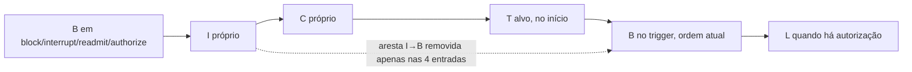

# 048 — Candidato localizado para item/orçamento

2026-10-09. **Proposta offline, sem migration criada ou aplicada.** Mantém a
correção item→claim do [047](047-single-item-claim-lock-candidate.md).
Base empírica: [comparação real](../registros/2026-10-09-single-item-comparativa-vector-prova.md).
O diff transversal do 045 continua sem aprovação.

## Resultado recuperado e limites da observação

O ciclo é real e terminou em SQLSTATE **40P01 nos dois clusters**, com rollback
igual ao snapshot sintético. O harness `lock_pairs.py` bloqueou manualmente o
item em A antes da RPC. B chamou naturalmente `block_work_on_budget`. Portanto,
a evidência comprova o ciclo sob esse escalonamento; não é medição de duas RPCs
sem pré-lock. A ordem efetiva do início permite o mesmo intervalo naturalmente,
mas essa reprodução adicional ainda precisa de PostgreSQL.

| Evidência | Baseline anterior | Candidato item/claim |
|---|---|---|
| A / virtual transaction | PID 27691 / 3/3164 | PID 26274 / 3/3020 |
| B / virtual transaction | PID 27698 / 4/63 | PID 26281 / 4/44 |
| XID de A bloqueando B | 1307 | 1276 |
| Item sintético | 6cecf0ca-bb4f-48e0-9bbe-c037fb4c5850 | 9c7f7917-ca1b-47ba-a973-320934ee0989 |
| Resultado A/B | exit 3 / 0; 40P01 | exit 3 / 0; 40P01 |
| Tempo do cenário, não latência de uma RPC | 0,731825 s | 0,741206 s |

Owner sintético comum: `4a5f6f70-4599-58d4-bac4-e1371cb4766f`;
claim `d5af523c-3bf0-59e4-a6c6-4c9f0f194759`;
attempt `45636fd5-78bf-5168-a4a0-e0f3ab663f37`.

1. A segura I por `SELECT ... FOR UPDATE`. B adquire o advisory transacional
   exclusivo B_u = `hashtextextended('autonomous_work_budget:'||owner,0)`;
   espera I, representado por ShareLock **não concedido no XID de A**.
2. Snapshot `locks-before` mostra A em ClientRead, B bloqueado por A e B_u
   concedido a B. Advisory PostgreSQL `[16384,815462361,2991672838,1]`;
   `classid=815462361`, `objid=2991672838`, `objsubid=1`. B possui também
   tuple AccessExclusiveLock, relation OID 19239, page 2/tuple 20 no candidato;
   isso **não** significa que B já obteve a linha SQL disputada: ainda espera XID.
3. A chama `start_claimed_work_attempt` → bloqueia seu claim C →
   `private.begin_work_attempt` → item reentrante → advisory alvo T → UPDATE I →
   INSERT work_events → trigger `private.enforce_autonomous_work_budget`.
   O trigger espera B_u. O relatório do servidor fecha a segunda aresta:
   A espera B_u de B e B espera o XID de A. O snapshot anterior isoladamente
   não mostra ambas as esperas simultâneas.
4. Contexto: trigger linha 7 PERFORM; `private.begin_work_attempt` linha 77 INSERT;
   start linha 35 baseline/60 candidato. A vítima registrada é A; B prossegue
   depois do aborto de A. Ambas as sessões terminam em rollback; snapshots e
   cleanup iguais, backendsAfter=0 (a limitação de application_name truncado no
   baseline é conservada no relatório anterior, não ocultada).

Os locks de C/T durante o segundo trecho são deduzidos dos corpos vigentes e do
contexto de execução; não chamar o snapshot anterior de medição deles. XID de B
não aparece nesse snapshot; virtual transaction está disponível, não inventar XID.

Fontes brutas em `docs/registros/2026-10-09-single-item-comparativa-evidencias/`:
`baseline/budget-item-residual/budget_item_residual-{result,locks-before}.json`,
`candidate/lock-pairs/budget_item_residual-{result,locks-before}.json`, fixtures,
sessões individuais, `postgres-server.stderr` e `lock_pairs.py`.
[Inventário/hashs](048-single-item-budget-lock-order-inventory.json) fixa seis fontes
brutas, todas as 155 migrations e as 161 definições efetivas; não substitui catálogo.

## Corpos efetivos e fechamento do domínio

I = work_items próprio; C = work_claims próprio; T = work_target owner/alvo;
B = autonomous_work_budget owner; L = work_budget_resume_authorizations;
R = work_reconciliation; H = work_recovery_successor; F = work_focus.
Uma leitura SELECT normal não recebe a mesma aresta que FOR UPDATE.

| Caminho efetivo | Fonte vigente | Ordem relevante / decisão |
|---|---|---|
| start_claimed_work_attempt(uuid,uuid,text) | 20261009000000_claim_item_lock_order_candidate | I→C→private.begin→T→B(trigger)→L(update condicional); antecipar B |
| release_work_claim(uuid,text) | mesma candidata 20261009 | I→C→evento; não toma B, manter integralmente |
| private.begin_work_attempt(uuid,uuid,integer,uuid,text,text,uuid) | 20260721000005_commanded_target_exclusivity | I→T→eventos; B só se claim_id não nulo; manter |
| start_commanded_work_attempt(uuid,integer,uuid,text) | 20260721000001_work_claims | wrapper private.begin com NULL claim; trigger orçamento retorna sem B; manter |
| start_work_execution(uuid,integer,uuid,text) | 20260715000004_persist_work_executions | evento legado sem claim_id; não participa dessa guarda; manter |
| begin_resumed_work_attempt(uuid,integer,uuid,bigint,bigint,uuid,uuid,text,integer,text) | 20260728000011_allow_adjustment_before_resumption | I→T→INSERT C→B(trigger); antecipar B |
| begin_human_decision_resumed_attempt(uuid,integer,uuid,uuid,uuid,uuid,text,integer,text) | 20260729000003_decision_resumption | I→T→INSERT C→B(trigger); antecipar B |
| begin_budget_interruption_resumed_attempt(uuid,integer,bigint,bigint,uuid,uuid,text,integer,text) | 20260821000001_budget_interruption_resumption | I→T→INSERT C→B(trigger); antecipar B |
| block_work_on_budget(uuid) | 20260821000000_budget_block_honest_and_readmission | B→I, decisão e bloqueio, manter |
| interrupt_work_on_budget(uuid,integer,uuid) | 20260728000014_interrupt_on_work_budget | B→I→C próprio da tentativa; manter |
| readmit_budget_blocked_work / interrupted_work() | 20260821000000 / 00001 | B→loop de I; helpers privados bloqueiam I, sem B próprio; manter |
| authorize_work_resume(uuid,integer,jsonb) | 20260905000000_budget_blocked_human_resume | B→I→INSERT L/FKs; manter |
| enforce_autonomous_work_budget() | 20260905000000_budget_blocked_human_resume | BEFORE INSERT execution_started com claim; B→decisão→UPDATE L; manter |
| autonomous_work_budget_decision / unattended_work_budget_decision | 20260905000004 / versões efetivas do inventário | leitores, supervisão/política existentes; manter |
| reconcile_supervised_work() | 20260928000004_pending_verification_human_recovery | R→I em ordem id→claims/eventos terminais, não inicia nem chama readmit; manter |
| authorize_work_resume(uuid,integer,uuid,jsonb), demais recovery | 20260903000000 / inventário | successor/root/H/FKs; overload diferente do orçamento; manter |
| acquire_work_claim / acquire_single_item_work_claim | 20260721000001 / 20261008000000 | I→T→C; global pode limpar estrangeiro expirado e tocar I_foreign por FK; manter, risco residual |

Busca nas 161 definições: exatamente dois chamadores SQL de private.begin,
start_claimed e start_commanded. Helpers privados readmit são chamados pelos
wrappers correspondentes. Chamadas de cliente, PL dinâmico futuro, DML privilegiado
ou composições na mesma transação não são certificadas por essa busca textual.
A ACL histórica revoga private.begin de PUBLIC/anon/authenticated; a comparação
real anterior conservou ACLs. Chamadas administrativas diretas ficam fora do contrato.

## Locks explícitos e implícitos

O ciclo comprovado usa FOR UPDATE de I e advisory B: não precisa de FK para existir.
A aquisição de B é explícita no corpo do trigger, **implícita para quem insere o
evento**. O INSERT execution_started dispara a guarda BEFORE INSERT, que preserva
a decisão de orçamento e pode atualizar L (lock de linha por UPDATE). Routing,
classificação e validação de payload permanecem ativos, sem prefixo tardio novo.
Updates de I/C também adquirem locks de linha e de relação; PK/índices únicos podem
esperar por transações concorrentes. Não confundir RowShareLock da tabela com
exclusividade da linha. Seq/índices não são tratados como prova de liberdade de ciclos.

FK work_claims.work_item_id e work_events.work_item_id solicita KEY SHARE no pai I;
FKs de owner apontam auth.users. L referencia item e evento bloqueador. Quando o
pai próprio já está bloqueado, é reentrante; claim estrangeiro/parent DELETE/admin
pode envolver outras linhas e ciclos. Trigger clear_terminal_work_focus muta F
em estados terminais; o início muda para in_progress, mas recovery/reconciliação
podem atingir outros estados. Nenhum desses triggers/FKs será desabilitado.

Grafo recomendado é **parcial e contextual**: B antes de I; I antes de C e T;
start preserva C→T e retomadas preservam T→INSERT C. Não anunciar ordem total
B→I→T→C: ela não descreve o start existente. Item comum serializa esses caminhos
no mesmo item; recursos entre itens continuam exigindo provas próprias.

## Alternativas e proposta mínima

| Alternativa | Escopo | Avaliação |
|---|---|---|
| Antecipar B só no start | um corpo | menor correção do par específico, deixa três retomadas com I→B; insuficiente como fechamento das admissões conhecidas |
| Antecipar B nas quatro admissões | quatro corpos | recomendada para candidato; reutiliza mutex de orçamento já obrigatório, sem serializar release/conclusão/classificação inteira |
| Mover block/interrupt para I→B | pelo menos dois corpos, mais readmit/authorize | conflita com readmit bulk B→I de outro item; deixa inversões e dificulta atomicidade da quota owner |
| try_advisory_xact_lock tardio / NOWAIT | trigger e protocolo de retry | quebra espera falhando fechado, mas muda erros e disponibilidade; não equivale a preservar 40P01/semântica; não recomendada agora |
| Mutex novo por item | participantes do mesmo item | não coordena quota compartilhada entre itens; duplica protocolo sem eliminar sozinho B→I |
| Prefixo B em 59 corpos | transversal | autoridade/throughput/manutenção desnecessariamente ampliados, sem garantia global por não participantes/multiowner; não aprovado |

[Diff completo](048-single-item-budget-lock-order.diff) e
[quatro CREATE OR REPLACE propostos](048-single-item-budget-lock-order-candidate.sql).
Cada corpo recebe somente o PERFORM da **mesma chave de orçamento existente**,
após auth/allowlist/argumentos e antes do primeiro lock de linha. No start,
descoberta própria sem lock e P0002 de claim inexistente permanecem antes de B.
Não existe decisão nem consumo antecipado: trigger continua ponto atômico da
admissão, decisão e consumo de L, reentrante em B. Admissão supervisionada também
passa pela guarda; não inferir bypass do lock pela classificação local.

Headers, argumentos, retorno, estado, eventos, identity/owner/correlação e checks
pós-espera do start são byte-preservados. Release e acquire não mudam. Não há
GRANT/REVOKE, alteração de ownership/RLS, budget/classificação/executor/gate ou
mudança em migration histórica. O SQL em docs é revisável, **não um arquivo
instalado em supabase/migrations**, e não está aplicado a banco algum.

## Riscos e contraexemplos

B é transacional: reentrância não libera o prefixo; duração é até COMMIT/ROLLBACK.
Admissões de itens independentes do mesmo owner já compartilham B no trigger,
mas agora esperas por I/C/T e replays também o retêm. Pode aumentar contenção,
latência e head-of-line blocking. Outro owner usa outra chave, salvo colisão de
hash/recursos globais. Sem garantia de fairness/starvation; limitar transações e
medir caudas, expiração de lease e custo do replay. B não protege toda mutação.

Contraexemplos offline mantidos, não contornados:

- Pré-lock I→novo start B ainda fecha I→B versus B→I. Pré-lock C→B também pode
  inverter B→I→C. acquire/start ou readmit/start na **mesma transação** devem ser
  tratados como pré-locks: o prefixo dentro da segunda RPC chega tarde. Não mudar
  o teste histórico para chamar isso de PASS_NO_DEADLOCK.
- Global acquire I_a→T→C_b→I_b/FK versus start B→I_b→T continua possível.
- Recovery successor→root versus operação root→successor, R→I_a→I_b versus
  composição I_b→I_a, foco I→F versus F→I/FK, parent/admin/paid/multiowner continuam
  fora da garantia. São dependências/contraexemplos, não novos 40P01 medidos hoje.
- Inverter só block para I→B não resolve readmit B→I_a→I_b e introduz conflito
  entre itens. Não é solução mínima segura do orçamento owner compartilhado.

As três retomadas conservam sua checagem inicial de allowlist, sem a rechecagem
pós-lock que start já tem. Espera adicional em B pode ampliar uma janela existente
de revogação; não alegar autoridade instantânea. Próxima prova deve medir esse
caso: se admitir após revogação quando contrato exigir recusa, NO-GO e nova revisão
específica, sem consertar o candidato durante a campanha. Snapshots READ COMMITTED
versus REPEATABLE READ/SERIALIZABLE e 40001 precisam ser registrados separadamente.
`now()`/v_now continuam transacionais; espera não atualiza lease ou janela móvel.
Argumentos inválidos preservam erros anteriores antes de B; item ausente/replay
válido nas retomadas pode agora esperar B antes do P0002/retorno. Erros de negócio
não mudam no trecho preservado, mas precedência temporal/timeout pode mudar.

## Prova PostgreSQL comparativa preparada, não executada

**Nova revisão humana e autorização de implementação/aplicação/ambientes são
necessárias antes de executar.** Não reutilizar containers anteriores nem seu
PGDATA tmpfs perdido. Nenhum comando Docker/SQL foi executado nesta sessão.

1. Congelar harness, fixtures, 272 etapas/556 hashes, imagem/limites do 047 e todos
   os hashes deste inventário. Baseline **novo desta comparação** = bootstrap
   original + candidata item/claim 20261009. Candidato = baseline + somente os
   quatro corpos revisados de orçamento em futura migration incremental.
   Não confundir esse baseline com o baseline pré-item/claim da prova anterior.
2. Dois clusters independentes, sequenciais, nonces/run ledgers/IDs completos
   distintos, network none, sem portas/binds/volumes/env residente, PGDATA tmpfs,
   socket exclusivo, 1 CPU/1 GiB sem swap adicional/64 PIDs, privilégios mínimos,
   imagem pinada do relatório anterior. Repetir recursos/isolamento e identidade
   antes de cada destino; Vector só pode ser exceção se independente novamente
   comprovado. Residente DB/Auth apenas saúde/metadados, nenhum dado/DDL.
3. Catálogo antes/depois com OIDs **dentro de cada cluster**, signatures/args/ret,
   owners/ACL/securityDefiner/search_path/atributos, pg_get_functiondef/prosrc,
   triggers/RLS/policies/FKs/constraints. Exigir alteração apenas dos quatro corpos;
   dois corpos item/claim comuns permanecem, release idêntico. SQL ON_ERROR_STOP
   em transação, hash/catálogo confirmados antes das provas.
4. Controle histórico idêntico (A manual I, B block, A start): exigir 40P01 no
   baseline; manter resultado adversarial no candidato, onde o pré-lock continua
   violando o protocolo. Ausência circunstancial não prova correção. Capturar
   stdout/stderr verbosos, SQLSTATE, pg_locks/pg_blocking_pids/activity e server log.
5. Controle positivo **RPC natural** reproduzível com terceira sessão S:
   fixture committed, claim próprio aberto sem attempt, rota/classificação válidas.
   S BEGIN; SELECT claim próprio FOR UPDATE, segurando somente C, sem I/B/T.
   A chama start naturalmente; aguardar e provar A bloqueado por S no claim.
   B chama block naturalmente. Baseline: provar B segura B e espera I de A.
   Candidato: provar A segura B/I e B espera B de A, sem possuir I.
   Liberar S por ROLLBACK. Baseline deve fechar 40P01 start/trigger versus block;
   candidato deve terminar sem 40P01, com resultado de negócio interpretável.
   A/B ROLLBACK; mesma fixture/snapshots. S é barreira de timing externa, não
   pré-lock da transação A nem alteração de função/trigger. Caso pré-condições de
   locks não sejam observadas, classificar INCONCLUSIVO e parar esse controle.
6. Matriz abaixo, mesmas seeds e schedules em ambos. Preservar todos os erros sem
   retry automático: statement/lock/idle timeout explícitos, cancelamento seguro,
   sessões fechadas, snapshots antes/rollback/cleanup. Fixture/runner falhando é
   resultado inconclusivo, nunca sucesso. Pelo menos 100 repetições por disputa
   natural principal, reportando distribuição e qual vítima, não só zero logs.
7. pgTAP 13 suítes/334 propriedades, incluindo 55 Single-Item e 123 históricas.
   Quatro FAIL históricos na suíte local/externo são baseline conhecido separado,
   **não** expectativas alteradas/skip. Exigir zero novas regressões. Não declarar
   PASS global de 334. Orçamento ainda deve recusar sétima tentativa/limites e
   conservar política supervisionada atual, inclusive consumo único/rollback L.
8. Performance com pelo menos 1000 **transações** de admissão e replay separadas,
   same-item, same-owner different-item/target, different-owner e bloqueio prolongado
   de C/I/T. p50/p95/p99, throughput, wait time/resource, timeout/starvation e lease.
   Comparar critério 046 (p95 +10% e throughput ≥95%) na carga válida; microbenchmark
   anterior de 1000 replays em apenas duas transações não basta nem é substituído.
9. Hashes/identidades/evidências independentes, integridade/recursos/residente antes
   e depois, ledger reconcile. GO só localizado com positivo baseline reproduzido,
   zero 40P01 novo no domínio natural, nenhuma alteração estrangeira/autorização/
   budget/RLS/ACL/estado e performance aceitável. Controle fora de protocolo e
   divergência histórica ficam visíveis. Não promover gate/produto automaticamente.

| Matriz obrigatória | Resultado exigido / limite |
|---|---|
| start/block natural, S bloqueia C | baseline 40P01 positivo; candidato sem ciclo B/I |
| start/interrupt; start/authorize budget (3 args) | estado/checkpoint/autoridade válidos ou erro canônico; sem nova inversão |
| três retomadas × block/interrupt/authorize/readmit | variantes naturais e states elegíveis; nenhum 40P01 novo no domínio coberto |
| release/start nos dois sentidos e acquire/start | preservar evidência item/claim; scoped nunca altera claim estrangeiro |
| owner diferente/claim estrangeiro/id redirecionado | P0002/42501/55000 conforme contrato, sem efeitos parciais |
| quota owner entre dois itens / último slot disponível | uma admissão, outra P0001; nenhuma sétima tentativa |
| grant humano consumo simultâneo e rollback | consumo único, correlação item/attempt; rollback restaura L/eventos/claim/estado |
| allowlist revogada durante espera, 4 entradas | start 42501 pós-lock; limitações de retomada reportadas e bloqueiam garantia mais ampla |
| ACL anon/authenticated/service, RLS cross-owner | sem privilégio/visibilidade novos; private.begin não exposto |
| retomada/checkpoint/decisão/reconcile/recovery | transições/guards e erros preservados; casos multi-item fora do protocolo identificados |
| pré-lock I/C, mesma transação acquire+start, multi-item inverso | controles adversariais separados, 40P01 ainda admissível fora do escopo |

## Estado de revisão

Candidato textual e testes determinísticos prontos. Não foi compilado PL/pgSQL,
aplicado ou testado em PostgreSQL. A revisão deve aprovar ou reduzir explicitamente
os quatro corpos e o contrato de transação limpa; somente depois autorizar migration
incremental/prova. Se o contrato exigir composições com pré-locks arbitrários,
esta proposta é insuficiente e deve ser rejeitada. A garantia item→claim permanece;
`single_item_atomic_claim_unavailable` continua ativo.

## Verificação offline desta sessão

13 testes novos PASS; conjunto Single-Item 97/97 PASS (33,687 s). Bootstrap
272 etapas e 556 hashes verificados sem divergência; 6.880 arquivos preexistentes
protegidos sem alteração. Inventário/diff/SQL continuam somente propostos.
[Registro e Git final](../registros/2026-10-09-single-item-budget-lock-order.md):
dev no mesmo HEAD, índice vazio, 46 worktrees preservadas. Próxima ação depende de
revisão humana; nenhuma prova PostgreSQL nova executada.

## Implementação candidata autorizada — 2026-10-09

[Plano 049](049-single-item-budget-lock-candidate.md) e migration incremental 20261009000001 implementam exclusivamente os quatro corpos, refinando o PERFORM incondicional deste rascunho: replay visível evita B/T, autoridades são rechecadas após esperas e start pré-adquire o mesmo T para observar revogação. Arquivos de proposta/diff/inventário 048 preservados. 112 testes Single-Item e 30 bootstrap offline PASS; três pacotes preparados, sem Docker/SQL/aplicação. Comparação futura original/item-claim/combinado usa barreira T natural e controles adversariais, mantendo quatro FAIL históricos separados. [Registro](../registros/2026-10-09-single-item-budget-lock-candidato.md); revisão humana antes de aplicação, gate ativo.
